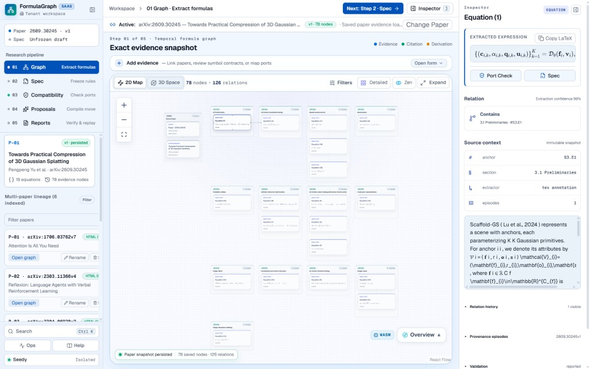
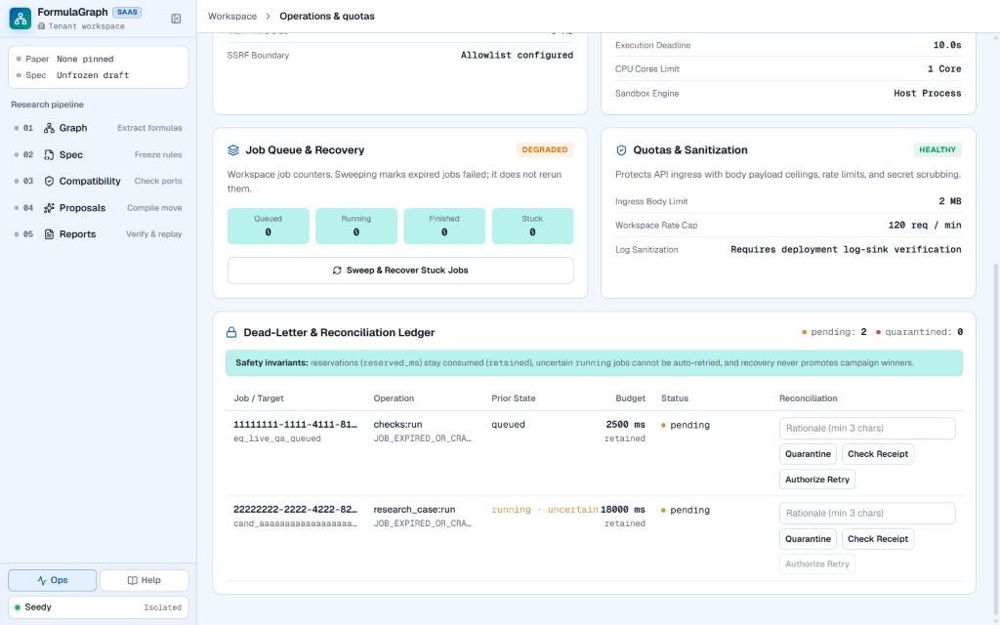
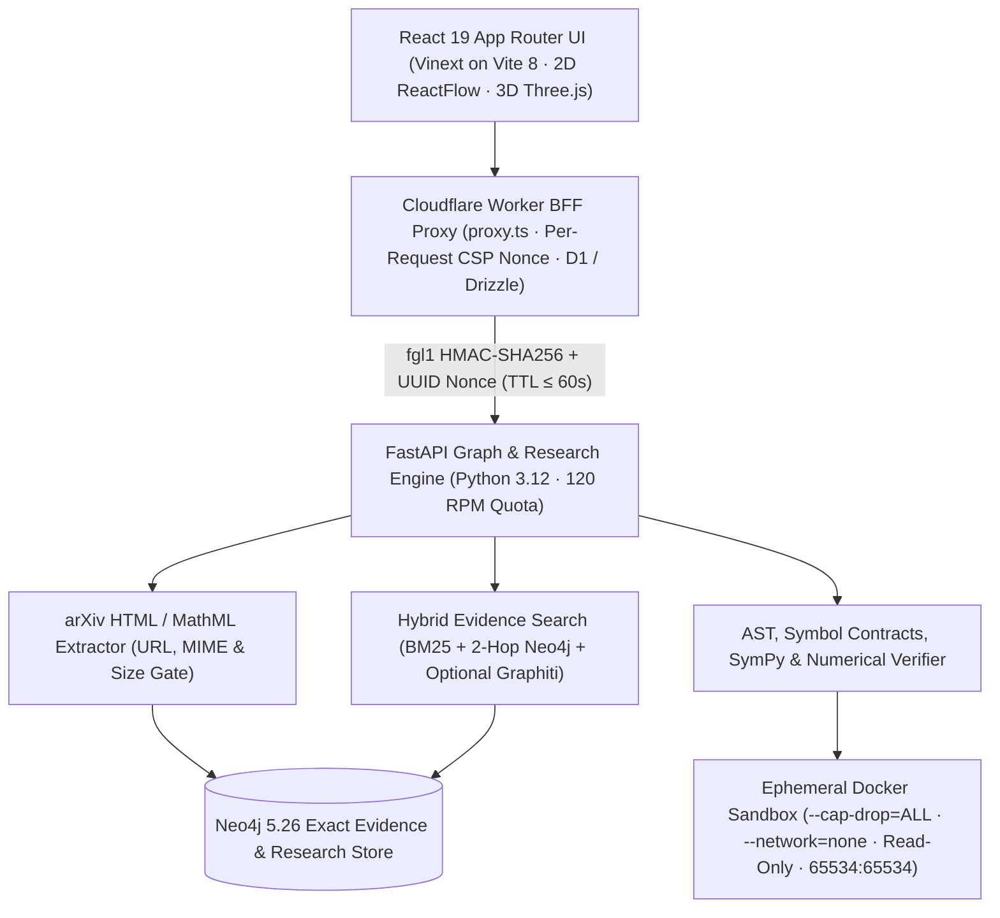

# FormulaGraph Lab

[](https://github.com/Yato742003/formula-graph-lab/actions/workflows/regression-ci.yml)
[](https://github.com/Yato742003/formula-graph-lab/actions/workflows/security-gates.yml)
[](https://github.com/cloudflare/vinext)
[](https://fastapi.tiangolo.com/)
[](https://python.org/)
[](https://typescriptlang.org/)
[](https://neo4j.com/)
[](https://developers.cloudflare.com/d1/)
[](LICENSE)

> **Source-bound mathematical knowledge graph and verification harness.**
> FormulaGraph Lab converts arXiv HTML papers into an immutable, provenance-tracked formula graph—strictly separating extracted ground-truth evidence from AI hypotheses, enforcing human-reviewed symbol contracts before symbolic or numerical execution, and running verification workers inside air-gapped Docker sandboxes.


| 2D Formula Graph & KaTeX Inspector | Visual Problem Spec Builder (G1) | `/ops` Dead-Letter & Reconciliation Ledger |
| :---: | :---: | :---: |
|  |  |  |

---

## Empirical Evaluation & Measured Benchmarks

All figures below are reproducible locally via [`scripts/benchmark_evidence.py`](scripts/benchmark_evidence.py) (`make benchmark`) and recorded in [`reports/benchmark-summary.json`](reports/benchmark-summary.json) and [`reports/phase5-retrieval-ab.json`](reports/phase5-retrieval-ab.json).

### 1. Frozen 14-Paper arXiv Excerpt Corpus (Extraction vs. Fail-Closed AST Parser)

Tested offline against **14 frozen arXiv HTML structure excerpts** (`1706.03762` Transformer, `1810.04805` BERT, `2005.14165` GPT-3, `2006.11239` DDPM, `2006.16236` Linear Transformers, `2009.14794` Performer, `2010.11929` ViT, `2103.00020` CLIP, `2106.09685` LoRA, `2205.14135` FlashAttention, `2210.02747` Flow Matching, `2302.13971` LLaMA, `2307.09288` Llama 2, and `2402.08954` arXiv HTML; `24` expected display equations):

| Stage | Result | Latency (Median / p95) | Fail-Closed Behavior |
| :--- | :---: | :---: | :--- |
| **Source HTML / MathML Anchor Extraction** | **`24 / 24` (`100.0%`)** | `0.59 ms` / `1.15 ms` | Preserves `S*.E*` anchors, SHA-256 source digest & `non_mathml_content_requires_review` warnings |
| **Typed Formula AST Parsing** | **`14 / 24` (`58.3%`)** | `0.18 ms` / `0.40 ms` | Intentionally rejects `10 / 24` blocks rather than hallucinating structure (`4` BERT text-as-math blocks, `4` unsupported macros like `\verb` / `\coloneqq` / `\mathbb{R}`, `1` `\widehat` accent, `1` trailing multi-part expression) |

> *Scope note:* This corpus exercises repeatable offline regression on 14 frozen arXiv HTML excerpts (including 2 zero-equation papers), not full-paper arXiv-wide precision/recall.

### 2. Worked Verification Cases & Ephemeral Docker Sandbox Latency

Measured on a pinned `Dockerfile.sandbox` image (`--network=none --read-only --cap-drop=ALL --security-opt=no-new-privileges:true --user=65534:65534`, 256 MB RAM, 1 CPU):

| Formula Pair (`LaTeX`) | Contract State | Outcome | Verification Vector / Witness | Wall Time |
| :--- | :--- | :---: | :--- | :---: |
| `(a + b) - b` vs `a` | Unreviewed symbols | `unknown` | `UNRESOLVED_SHAPE` (preflight blocks before spawning Docker) | `0.2 ms` |
| `(a + b) - b` vs `a` | Reviewed scalar reals (`a, b`) | **`supported`** | `domain: discharged`, `sympy_simplify (difference = 0)` | `1023.9 ms` |
| `(a + 1) + 2` vs `a + 4` | Reviewed scalar real (`a`) | **`refuted`** | `domain: discharged`, `exact_constant_difference = -1` | `930.1 ms` |
| `\frac{1}{x}` vs `x^{-1}` | Reviewed real (`x`, no `x ≠ 0`) | `unknown` | `UNRESOLVED_DOMAIN` (denominator obligation blocks false proof) | `0.5 ms` |

**Ephemeral Container Lifecycle Latency (`docker run` → execute → verify → `docker rm -f`):**

| Worker Kind | Runs | Min | Median | p95 |
| :--- | :---: | :---: | :---: | :---: |
| **Symbolic SymPy Worker (`app.symbolic_worker`)** | 5 | `780.7 ms` | **`828.5 ms`** | `896.4 ms` |
| **Numerical Feature-Map Suite (`app.numerical_worker`)** | 3 | `399.8 ms` | **`401.5 ms`** | `420.7 ms` |

### 3. Offline Retrieval A/B (`reports/phase5-retrieval-ab.json`)

Four fixed anchor-finding queries × 3 alternating repeats on isolated Neo4j (`k = 5`, zero LLM API calls):

| Metric | Existing Baseline (Kept Default) | Experimental (`bounded-source-neighbors.v1`) |
| :--- | :---: | :---: |
| Correct requested source anchor | `12 / 12` | `12 / 12` |
| `Recall@5` / `Precision@5` | `1.00` / `0.20` | `1.00` / `0.20` |
| Latency (`p50` / `p95`) | **`8.26 ms`** / `145.61 ms` | `18.54 ms` / `190.86 ms` |
| Estimated Context Tokens / Model API Cost | `819` / `$0` | `877.5` / `$0` |

**Decision:** Kept baseline retrieval as default (`not_promoted_requires_larger_independent_heldout_corpus`) because the experimental neighbor-reranker added latency without improving anchor recall on this corpus.

### 4. Automated Test & Release-Gate Coverage

- **Offline regression (`make verify` / `scripts/verify-research.ps1`):** `700` Pytest tests + `208` Vitest tests (`28` files) + Ruff (`0` errors) + Oxlint (`0` errors) + `tsc --noEmit` (`0` errors).
- **Live isolated Neo4j integration (`make test-integration` / `scripts/test-integration.ps1`):** `35` integration tests on ephemeral tmpfs `neo4j:5.26-community` (including signed `fgl1` auth replay rejection, double-delivery quarantine, and dead-letter reconciliation).
- **Adversarial Docker sandbox & clean-container replay (`make test-sandbox` / `scripts/test-sandbox.ps1`):** `7` container boundary tests (controls, OOM kill, wall-clock kill, stdout flood cap, read-only rootfs, network lockdown) + `1` zero-network replay test.
- **Production HTTP/CSP smoke (`tests/production-security-smoke.mjs`):** Verifies per-request SSR CSP script nonces, `Cache-Control: no-store`, `X-Content-Type-Options: nosniff`, and fail-closed anonymous BFF denial.

---

## Key Capabilities

### 1. Dual-Mode 2D & 3D Evidence Workbench (5-Step Pipeline)
- **Unified Workspace Shell**: Five-stage workflow (`01 Graph` → `02 Spec` → `03 Compatibility` → `04 Proposals` → `05 Reports`) plus `/ops` control plane and `/help`.
- **2D Section Swimlanes (`@xyflow/react`)**: Structured view of papers, sections, extracted equations (`S*.E*`), and symbol contracts.
- **3D Sacred Timeline (`Three.js` / WebGL)**: Deterministic golden-angle volumetric layout with dynamic camera framing for exploring derivation lineage.

### 2. Source-Bound arXiv HTML / MathML Extraction
- Strict ingestion gate accepts only canonical `https://arxiv.org/html/\d{4}\.\d{4,5}(v\d+)?` URLs with bounded redirects, MIME validation, and size caps.
- Extracts MathML/LaTeX fragments with immutable SHA-256 source digests, exact HTML anchors, section hierarchy, and explicit extraction warnings.

### 3. Fail-Closed AST, Symbol Contracts & Bounded Verification
- **Formula AST Parser (`formula_ast.py`)**: Deterministic parser with explicit node/depth budgets and alpha-canonicalization; unsupported LaTeX fails closed instead of guessing.
- **Human-Reviewed Symbol Contracts (`symbol_contracts.py`)**: Separates inferred hints from append-only human `ContractReview` records covering category (`scalar`/`vector`/`matrix`/`tensor`/`function`), shape, domain (`real`/`positive`/`non_negative`/`integer`/`complex`), normalization, causality, and denominator/log domain obligations.
- **Layered Verification (`verification.py`, `numerical_verification.py`, `research_case.py`)**:
  - Bounded SymPy symbolic equivalence & counterexample detection inside `Dockerfile.sandbox`.
  - Numerical feature-map fixture suite (`float32`/`float64`, causal perturbation checks) for compiled candidate transforms.
  - CPU-only synthetic Performer/Linear-Attention pilot (`attention-mashup-cpu-synthetic.v1`) with locked holdout confirmation, Pareto finalist freeze, and zero-network deterministic bundle replay (`synthetic_operator_only_no_product_claim`).

### 4. Defense-in-Depth Sandbox, Telemetry Correlation & Dead-Letter Recovery
- **Execution Profile Pinning (`sandbox-policy.v2`)**: Captures image digest (`sha256:...`), RAM, CPU, PID, and timeout bounds at enqueue time and aborts immediately on `EXECUTION_PROFILE_DRIFT`.
- **End-to-End Request Correlation (FGL-603)**: BFF routes propagate `x-request-id` ↔ `x-upstream-request-id` with secret/note redaction across Next.js BFF logs and FastAPI JSON telemetry.
- **Controlled Dead-Letter Reconciliation (`/ops`)**: Distinguishes `prior_state = queued` vs `running` on expired/crashed jobs; enforces hard safety invariants (**no auto-retry on uncertain `running` jobs**, **no refund of `reserved_ms`**, **never promotes campaign winners**).

---

## Architecture & Stack Notes



**Why `vite.config.ts`, `next.config.ts`, `wrangler.json`, and `drizzle.config.ts` coexist:**
The frontend uses **[Vinext](https://github.com/cloudflare/vinext)** (`vinext dev` / `vinext build`), which runs the Next.js App Router on **Vite 8 + `@cloudflare/vite-plugin` + Cloudflare Workers**, with tenant workspace ownership stored in **Cloudflare D1** via **Drizzle ORM** (`db/schema.ts`, migrations in `drizzle/`). `vite.config.ts` wires Vinext and Cloudflare Workers together, while `next.config.ts` remains minimal for Vinext compatibility.

---

## Trade-offs & Design Decisions

- **Immutable Evidence vs. AI Hypotheses:** Paper-extracted equations carry cryptographic hashes and source HTML anchors so proposers can never overwrite ground truth; hypotheses live in a separate reviewable proposal/candidate tier, and AI generation flags stay **fail-closed (`false`)** by default.
- **Ephemeral Air-Gapped Containers Over In-Process `eval`:** Spawning a fresh non-root Docker container adds ~`400–830 ms` median overhead per job in exchange for hard kernel isolation (`--network=none`, `--read-only`, `--cap-drop=ALL`, cgroup memory/PID caps).
- **Signed Graph-API Boundary (No Direct Browser-to-Neo4j Access):** Every BFF → FastAPI call carries an `fgl1.<claims>.<HMAC-SHA256>` token bound to HTTP method, raw path/query, SHA-256 body hash, and a single-use UUID nonce atomically consumed in Neo4j.
- **Fail-Closed Supply-Chain Gates:** Code regression & dependency audits ([`.github/workflows/regression-ci.yml`](.github/workflows/regression-ci.yml)) run separately from Trivy container CVE scanning ([`.github/workflows/security-gates.yml`](.github/workflows/security-gates.yml)), which intentionally omits `--ignore-unfixed` and `continue-on-error` (enforced by [`test_deployment_security.py`](services/graph-api/tests/test_deployment_security.py)) so unpatched upstream Debian OS advisories stay visible rather than silently green.

---

## Quickstart

### Prerequisites
- **Node.js** `>= 22.13`
- **Python** `>= 3.12` (with [`uv`](https://docs.astral.sh/uv/) or `venv`)
- **Docker** (for Neo4j and ephemeral sandbox workers)

### Option A — macOS / Linux (`Makefile`)

```bash
cp .env.example .env      # Set NEO4J_PASSWORD and SERVICE_TOKEN (32+ ASCII chars)
make setup                # Install Node + Python deps and apply local Cloudflare D1 migrations
make db-up                # Start Neo4j 5.26 on 127.0.0.1:7474 / 7687
make api                  # Terminal 1: FastAPI Graph API on http://127.0.0.1:8000
make web                  # Terminal 2: Vinext dev server on http://localhost:3000
```

### Option B — Windows One-Command Runner (`PowerShell`)

```powershell
.\scripts\run.ps1         # Provisions secrets in .env, starts Neo4j, FastAPI (:8000) & Vinext (:3000)
.\scripts\stop.ps1        # Cleanly stops all services and containers
```

### Manual Setup (All Platforms, Including Cloudflare D1 / Drizzle)

1. **Neo4j 5.26:**
   ```bash
   docker compose up -d neo4j
   ```
2. **Cloudflare D1 Local Migrations (Drizzle ORM):**
   ```bash
   npm install
   npx wrangler d1 migrations apply site-creator-d1 --local
   ```
3. **FastAPI Graph API (Python 3.12):**
   ```bash
   python -m venv .venv
   # macOS/Linux: source .venv/bin/activate | Windows: .\.venv\Scripts\Activate.ps1
   pip install -e "./services/graph-api[dev]"
   uvicorn app.main:app --app-dir services/graph-api --reload --host 127.0.0.1 --port 8000
   ```
4. **Vinext Frontend (App Router on Vite + Cloudflare Workers):**
   ```bash
   npm run dev
   ```

- Web Workbench: `http://localhost:3000` (`/ops` for Operations & Dead-Letter Ledger)
- Graph API Docs: `http://127.0.0.1:8000/docs`
- Neo4j Browser: `http://127.0.0.1:7474`

---

## Environment Configuration

Copy [`.env.example`](.env.example) to `.env`:

| Variable | Description | Default / Notes |
| :--- | :--- | :--- |
| `NEO4J_URI` / `NEO4J_USER` / `NEO4J_PASSWORD` | Neo4j Bolt connection credentials | `bolt://127.0.0.1:7687`, `neo4j` |
| `GRAPH_API_URL` | Upstream FastAPI URL used by the BFF proxy | `http://localhost:8000` |
| `SERVICE_TOKEN` | HMAC-SHA256 shared secret between BFF and FastAPI | 32–256 ASCII chars (auto-generated by `scripts/run.ps1`) |
| `FGL_RESEARCH_QUEUE_SECRET` | Independent HMAC key for signed worker job envelopes | Must differ from `SERVICE_TOKEN` and worker tokens |
| `FGL_WORKER_IDENTITIES` | JSON array of scoped worker identities & workspace grants | Required for live queue telemetry & `/ops` recovery |
| `FGL_ENABLE_*` flags | Research checks, compiler, proposals, semantic enrichment | All default **`false`** (fail-closed) |
| `OPENAI_API_KEY` | Optional provider key for proposal drafting / Graphiti | Unset by default (offline BM25 + graph fallback) |

---

## Verification, Benchmarks & Replay

| Check | macOS / Linux (`Makefile`) | Windows (`PowerShell`) |
| :--- | :--- | :--- |
| **Offline Gate** (Ruff + 700 Pytest + Oxlint + `tsc` + 208 Vitest) | `make verify` | `powershell -NoProfile -File .\scripts\verify-research.ps1` |
| **Live Neo4j Integration** (isolated tmpfs Neo4j, 35 tests) | `make test-integration` | `powershell -NoProfile -File .\scripts\test-integration.ps1` |
| **Docker Sandbox & Clean Replay** (7 isolation + 1 replay) | `make test-sandbox` | `powershell -NoProfile -File .\scripts\test-sandbox.ps1` |
| **Empirical Corpus + Sandbox Benchmark** | `make benchmark` | `python scripts/benchmark_evidence.py --sandbox-image <sha256>` |
| **Offline Bundle Replay** (`--network none`) | `make replay BUNDLE=campaign.json EVOLUTION=1` | `powershell -NoProfile -File .\scripts\replay-bundle.ps1 -Bundle campaign.json -Evolution` |
| **Production Build & HTTP/CSP Smoke** | `make build` + `node tests/production-security-smoke.mjs http://127.0.0.1:4173` | `npm run build` + `node tests/production-security-smoke.mjs http://127.0.0.1:4173` |

---

## Documentation, Scope Boundaries & Roadmap

- [**`PRODUCT.md`**](./PRODUCT.md) — Product positioning, epistemic guarantees & accessibility contracts
- [**`DESIGN.md`**](./DESIGN.md) — OKLCH design tokens, typography & 2D/3D viewport rules
- [**`docs/PHASE5_COMPLETION.md`**](./docs/PHASE5_COMPLETION.md) — Phase 5 handoff: bounded evolution, locked holdout, retrieval A/B & replay
- [**`reports/FGL602_FGL603_HARDENING.md`**](./reports/FGL602_FGL603_HARDENING.md) — Sprint 6 security hardening, execution profiles & FGL-603 telemetry/DLQ verification
- [**`reports/REMAINING_WORK.md`**](./reports/REMAINING_WORK.md) — Known scope limits & pre-production deployment checklist (staging multi-tenant ingress verification, external append-only audit sink, D1/Neo4j backup drill, and upstream Debian base-image CVE tracking)

---

## License

This project is licensed under the [MIT License](LICENSE).
