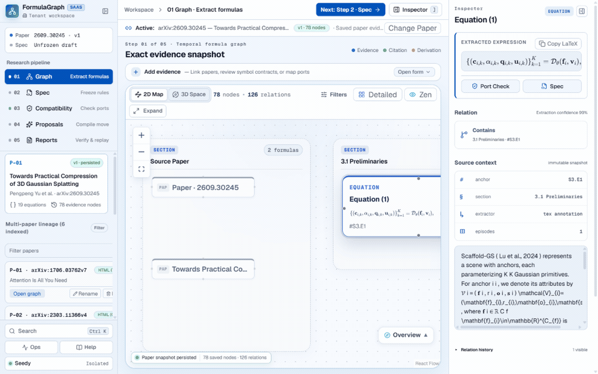
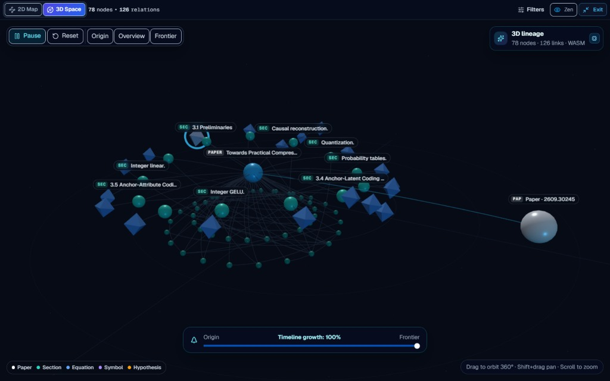
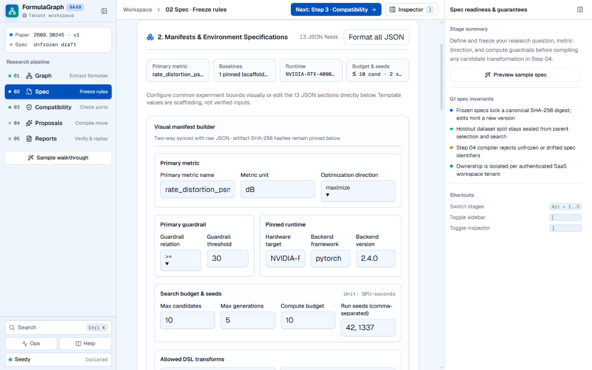
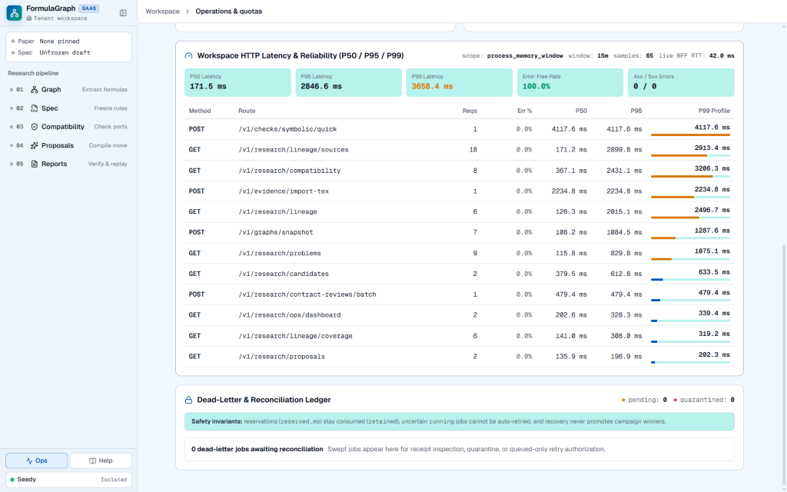
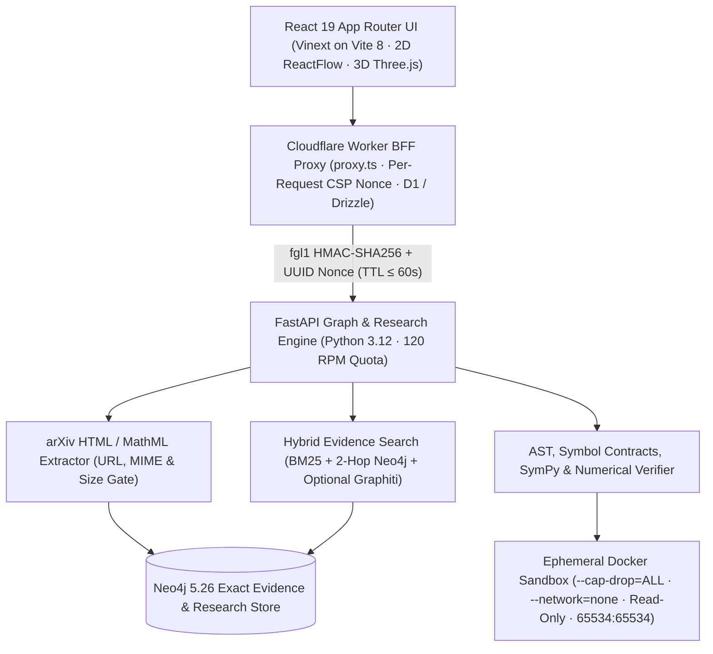

# FormulaGraph Lab

[](https://github.com/Yato742003/formula-graph-lab/actions/workflows/regression-ci.yml)
[](https://github.com/Yato742003/formula-graph-lab/actions/workflows/security-gates.yml)
[](https://github.com/cloudflare/vinext)
[](https://fastapi.tiangolo.com/)
[](https://python.org/)
[](https://typescriptlang.org/)
[](crates/formula-layout-wasm)
[](https://neo4j.com/)
[](https://developers.cloudflare.com/d1/)
[](LICENSE)

> **Source-bound mathematical knowledge graph and verification harness.**
> FormulaGraph Lab converts arXiv HTML papers into an immutable, provenance-tracked formula graph—strictly separating extracted ground-truth evidence from AI hypotheses, enforcing human-reviewed symbol contracts before symbolic or numerical execution, and running verification workers inside air-gapped Docker sandboxes.



| 2D Unified Formula Graph (Rust/WASM Worker) | 3D Scientific Observatory (`InstancedMesh` · 360° Orbit) |
| :---: | :---: |
|  |  |
| **Visual Problem Spec Builder (G1)** | **`/ops` P50/P95/P99 Latency & Dead-Letter Telemetry** |
|  |  |

---

## Researcher daily workflow

In **Graph**, choose **.tex / LaTeX** to upload a single UTF-8 file or paste display math (up to 512 KiB of source). Safe preamble macros (`\newcommand`, `\renewcommand`, `\providecommand`, `\DeclareMathOperator`) expand deterministically under strict cycle, depth, step, and size ceilings while keeping raw `source_sha256` and `source_fragments` immutable. The Inspector shows local provenance and line anchors. Each aligned environment remains one evidence block. External TeX includes are ignored.

Select an equation and open **Batch Review**. Apply a preset or edit individual shape and domain values, select the symbols, enter your rationale, and approve. Each selected symbol gets its own immutable review.

Enter a proposed rewrite or switch to **Derivation chain** (up to 8 ordered steps `E_0 ⇒ E_1 ⇒ ... ⇒ E_k`) under **Quick Verify**. The server loads canonical `E_0` from your workspace, maps accepted human `ContractReview` records to explicit SymPy assumptions (keeping matrices non-commutative and branch cuts sound without `force=True`), discharges implied domain obligations (such as `x^2 >= 0` or `x > 0`), pinpoints the exact failing step on refutation, and optionally exports a pinned Mathlib **Lean 4 `DRAFT_SORRY` theorem** verified by an independent **Five-Bin Statement Auditor** (`DECLARATION_FIDELITY`, `DRAFT_ALLOWLIST`, `PROOF_STATUS: FROZEN_UNPROVED`). Every verdict stays scoped to **ad-hoc check · not frozen campaign**.

For local execution, run `powershell -File .\scripts\run.ps1 -WithSandbox` (add `-ApiPort 8011` if port 8000 is occupied). On macOS/Linux use `make dev-sandbox` and `make web` in separate terminals after configuring the local environment. Set `API_PORT` and the BFF's `GRAPH_API_URL` together when changing ports. The launcher builds the worker image, pins its digest, and enables research checks for the API process. It scopes the local verifier to the simulated Sites user.

## Empirical Evaluation & Measured Benchmarks

All figures below are reproducible locally via [`scripts/benchmark_evidence.py`](scripts/benchmark_evidence.py) (`make benchmark`) and recorded in [`reports/benchmark-summary.json`](reports/benchmark-summary.json) and [`reports/phase5-retrieval-ab.json`](reports/phase5-retrieval-ab.json).

### 1. Frozen 14-Paper arXiv Excerpt Corpus (Extraction vs. Fail-Closed AST Parser)

Tested offline against **14 frozen arXiv HTML structure excerpts** (`1706.03762` Transformer, `1810.04805` BERT, `2005.14165` GPT-3, `2006.11239` DDPM, `2006.16236` Linear Transformers, `2009.14794` Performer, `2010.11929` ViT, `2103.00020` CLIP, `2106.09685` LoRA, `2205.14135` FlashAttention, `2210.02747` Flow Matching, `2302.13971` LLaMA, `2307.09288` Llama 2, and `2402.08954` arXiv HTML; `24` expected display equations):

| Stage | Result | Latency (Median / p95) | Fail-Closed Behavior |
| :--- | :---: | :---: | :--- |
| **Source HTML / MathML Anchor Extraction** | **`24 / 24` (`100.0%`)** | `0.60 ms` / `1.66 ms` | Preserves `S*.E*` anchors, SHA-256 source digest & `non_mathml_content_requires_review` warnings |
| **Typed Formula AST Parsing** | **`19 / 24` (`79.2%`)** (`19/19` genuine math) | `0.28 ms` / `0.70 ms` | Supports `\coloneqq`, accent-preserving `\widehat`, `\in \mathbb{R}^{...}` domain/shape clauses, norms (`‖·‖`) & conditional/slice notation; intentionally rejects `5 / 24` non-math blocks (`4` BERT text-as-math blocks + `1` GPT-3 `\verb` code block) |

> *Scope note:* This corpus exercises repeatable offline regression on 14 frozen arXiv HTML excerpts (including 2 zero-equation papers), not full-paper arXiv-wide precision/recall.

### 2. Worked Verification Cases & Ephemeral Docker Sandbox Latency

Measured on a pinned `Dockerfile.sandbox` image (`--network=none --read-only --cap-drop=ALL --security-opt=no-new-privileges:true --user=65534:65534`, 256 MB RAM, 1 CPU):

| Formula Pair (`LaTeX`) | Contract State | Outcome | Verification Vector / Witness | Wall Time |
| :--- | :--- | :---: | :--- | :---: |
| `(a + b) - b` vs `a` | Unreviewed symbols | `unknown` | `UNRESOLVED_SHAPE` (preflight blocks before spawning Docker) | `0.5 ms` |
| `(a + b) - b` vs `a` | Reviewed scalar reals (`a, b`) | **`supported`** | `domain: discharged`, `sympy_simplify (difference = 0)` | `1280.0 ms` |
| `(a + 1) + 2` vs `a + 4` | Reviewed scalar real (`a`) | **`refuted`** | `domain: discharged`, `exact_constant_difference = -1` | `1142.9 ms` |
| `\frac{1}{x}` vs `x^{-1}` | Reviewed real (`x`, no `x ≠ 0`) | `unknown` | `UNRESOLVED_DOMAIN` (denominator obligation blocks false proof) | `1.2 ms` |

**Ephemeral Container Lifecycle Latency (`docker run` → execute → verify → `docker rm -f`):**

| Worker Kind | Runs | Min | Median | p95 |
| :--- | :---: | :---: | :---: | :---: |
| **Symbolic SymPy Worker (`app.symbolic_worker`)** | 5 | `836.9 ms` | **`1060.5 ms`** | `1122.7 ms` |
| **Numerical Feature-Map Suite (`app.numerical_worker`)** | 3 | `399.9 ms` | **`407.8 ms`** | `416.3 ms` |

### 3. Offline Retrieval A/B (`reports/phase5-retrieval-ab.json`)

Four fixed anchor-finding queries × 3 alternating repeats on isolated Neo4j (`k = 5`, zero LLM API calls):

| Metric | Existing Baseline (Kept Default) | Experimental (`bounded-source-neighbors.v1`) |
| :--- | :---: | :---: |
| Correct requested source anchor | `12 / 12` | `12 / 12` |
| `Recall@5` / `Precision@5` | `1.00` / `0.20` | `1.00` / `0.20` |
| Latency (`p50` / `p95`) | **`8.26 ms`** / `145.61 ms` | `18.54 ms` / `190.86 ms` |
| Estimated Context Tokens / Model API Cost | `819` / `$0` | `877.5` / `$0` |

**Decision:** Kept baseline retrieval as default (`not_promoted_requires_larger_independent_heldout_corpus`) because the experimental neighbor-reranker added latency without improving anchor recall on this corpus.

### 4. Automated Test & Release-Gate Coverage

- **Offline regression (`make verify` / `scripts/verify-research.ps1`):** `795` Pytest tests (including `Hypothesis` PBT invariants, Threat Model P1 adversarial/sharp-edge regression, `fgl-mcp` 7-tool protocol + `--env-file` secret-allowlist + 10-question XML eval suite, `WorkspaceTelemetryTracker` P50/P95/P99 tenant-isolation tests, and Neo4j transient retention guard tests) + `230` Vitest tests (`35` files, including live `public/wasm/formula-layout.wasm`, `.tex` import, batch contract review, SymPy assumptions/domain discharge, multi-step derivation chains, Lean 4 five-bin audit, `/ops` latency/BFF-RTT telemetry, and `fast-check` BFF PBT invariants) + `6` Rust crate tests (including `proptest` 2D 0-overlap/containment & 3D constellation invariants) + Ruff (`0` errors) + Oxlint (`0` errors) + `tsc --noEmit` (`0` errors).
- **Live isolated Neo4j integration (`make test-integration` / `scripts/test-integration.ps1`):** `35` integration tests on ephemeral tmpfs `neo4j:5.26-community` (including signed `fgl1` auth replay rejection, double-delivery quarantine, and dead-letter reconciliation).
- **Adversarial Docker sandbox & clean-container replay (`make test-sandbox` / `scripts/test-sandbox.ps1`):** `8` container boundary & assumption-aware SymPy tests (controls, OOM kill, wall-clock kill, stdout flood cap, read-only rootfs, network lockdown, positive vs real radical & non-commutative matrix checks) + `1` zero-network replay test.
- **Isolated Disaster-Recovery Backup & Restore Drill (`make drill-backup-restore` / `scripts/drill-backup-restore.ps1`):** Automated end-to-end drill on isolated local Cloudflare D1 (`wrangler d1 export --no-data` + `--no-schema` → destroy → restore, **RTO `2,983 ms`**, 4/4 table & cross-store `source_sha256` parity) and Docker `neo4j:5.26-community` (`prune_expired_transient_records` → `neo4j-admin database dump` → destroy volume → `database load`, **RTO `14,676 ms`**, 100% evidence/review/check/search parity). Recorded in [`reports/backup-restore-drill-receipt.json`](reports/backup-restore-drill-receipt.json).
- **Production HTTP/CSP smoke (`tests/production-security-smoke.mjs`):** Verifies per-request SSR CSP script nonces, `Cache-Control: no-store`, `X-Content-Type-Options: nosniff`, and fail-closed anonymous BFF denial.

---

## Key Capabilities

### 1. Dual-Mode 2D & 3D Evidence Workbench (5-Step Pipeline)
- **Unified Workspace Shell**: Five-stage workflow (`01 Graph` → `02 Spec` → `03 Compatibility` → `04 Proposals` → `05 Reports`) plus `/ops` control plane and `/help`.
- **2D Unified Section Swimlanes (`@xyflow/react` + Rust/WASM Worker)**: Off-main-thread `wasm32-unknown-unknown` layout engine (`crates/formula-layout-wasm`, `63 KB`) with variable-height KaTeX + symbol-chip packing, Sugiyama barycenter ordering, balanced sub-column folding, and consistent lane framing across both equation-rich and text-only papers.
- **3D Scientific Observatory (`Three.js` Lazy Chunk + `InstancedMesh`)**: Dynamically split WebGL chunk using GPU instanced polyhedra (`<= 6` draw calls), merged quadratic Bézier edge buffers, two-tier equation/section hierarchy, collision-culled 2D hub labels, and 360° damped spherical orbit/pan controls.

### 2. Source-Bound arXiv HTML / MathML Extraction
- Strict ingestion gate accepts only canonical `https://arxiv.org/html/\d{4}\.\d{4,5}(v\d+)?` URLs with bounded redirects, MIME validation, and size caps.
- Extracts MathML/LaTeX fragments with immutable SHA-256 source digests, exact HTML anchors, section hierarchy, and explicit extraction warnings.

### 3. Fail-Closed AST, Symbol Contracts & Bounded Verification
- **Formula AST Parser (`formula_ast.py`)**: Deterministic parser with explicit node/depth budgets and alpha-canonicalization; unsupported LaTeX fails closed instead of guessing.
- **Human-Reviewed Symbol Contracts (`symbol_contracts.py`)**: Separates inferred hints from append-only human `ContractReview` records covering category (`scalar`/`vector`/`matrix`/`tensor`/`function`), shape, domain (`real`/`positive`/`non_negative`/`integer`/`complex`), normalization, causality, and denominator/log domain obligations.
- **Layered Verification (`verification.py`, `numerical_verification.py`, `research_case.py`)**:
  - Bounded SymPy symbolic equivalence & counterexample detection inside `Dockerfile.sandbox`.
  - Numerical feature-map fixture suite (`float32`/`float64`, causal perturbation checks) for compiled candidate transforms.
  - CPU-only synthetic Performer/Linear-Attention pilot (`attention-mashup-cpu-synthetic.v1`) with locked holdout confirmation, Pareto finalist freeze, and zero-network deterministic bundle replay (`synthetic_operator_only_no_product_claim`).

### 4. Defense-in-Depth Sandbox, Telemetry Correlation, Latency Observability & Dead-Letter Recovery
- **Execution Profile Pinning (`sandbox-policy.v2`)**: Captures image digest (`sha256:...`), RAM, CPU, PID, and timeout bounds at enqueue time and aborts immediately on `EXECUTION_PROFILE_DRIFT`.
- **End-to-End Request Correlation & `/ops` P50/P95/P99 Telemetry**: BFF routes propagate `x-request-id` ↔ `x-upstream-request-id` plus `x-bff-duration-ms` round-trip timing; FastAPI maintains a bounded, tenant-partitioned 15-minute sliding window (`WorkspaceTelemetryTracker`) surfacing honest per-route `P50 / P95 / P99` latency, `4xx / 5xx` counts, and error-free rate on `/ops` (rendering an explicit empty state rather than fake zeros when `sample_count == 0`).
- **Controlled Dead-Letter Reconciliation (`/ops`)**: Distinguishes `prior_state = queued` vs `running` on expired/crashed jobs; enforces hard safety invariants (**no auto-retry on uncertain `running` jobs**, **no refund of `reserved_ms`**, **never promotes campaign winners**).

### 5. Agent-Native MCP Server (`fgl-mcp`)
Expose FormulaGraph Lab's deterministic verification engines directly to IDE coding agents (Claude Desktop, Cursor, Codex, Antigravity) over **`stdio`** (default) or **`streamable-http`** (`--transport streamable-http --host 127.0.0.1 --port 8765`), installed via `pip install -e "./services/graph-api[mcp]"`:
- **7 Read-Only Scientific Tools:** `fgl_extract_tex`, `fgl_analyze_formula`, `fgl_check_compatibility`, `fgl_verify_derivation` (single rewrite & multi-step chains up to 8 steps), `fgl_export_lean4_draft`, `fgl_audit_lean4_statement` (five-bin protocol, pairs with `lean-lsp-mcp`), and `fgl_search_evidence` (optional read-only workspace-scoped Neo4j search).
- **2 MCP Resources & 10-Question Eval Suite:** `fgl://policy/epistemic-boundaries`, `fgl://schema/contract-presets`, and [`services/graph-api/evals/fgl_mcp_eval.xml`](services/graph-api/evals/fgl_mcp_eval.xml).
- **Fail-Closed Symbolic Execution:** Runs inside pinned Docker sandbox (`FGL_SANDBOX_IMAGE=sha256:...`) when configured; otherwise stops at AST + contract + SymPy domain preflight (`preflight_only`) unless explicitly opted into `--allow-local-subprocess` (or `FGL_MCP_ALLOW_LOCAL_SUBPROCESS=true`).

```json
{
  "mcpServers": {
    "formula-graph-lab": {
      "command": "python",
      "args": [
        "-m", "app.mcp_server",
        "--transport", "stdio",
        "--allow-local-subprocess",
        "--env-file", ".env"
      ],
      "env": {
        "PYTHONPATH": "services/graph-api",
        "FGL_MCP_WORKSPACE_ID": "<your-workspace-id>"
      }
    }
  }
}
```
> `--env-file` reads only allowlisted Neo4j/MCP variables (`NEO4J_*`, `SEARCH_CURSOR_SECRET`, `FGL_SANDBOX_IMAGE`, `FGL_MCP_*`) and never imports `SERVICE_TOKEN`, `OPENAI_API_KEY`, or `FGL_RESEARCH_QUEUE_SECRET`, keeping IDE `mcp_config.json` free of plaintext passwords.

---

## Architecture & Stack Notes



**Why `vite.config.ts`, `next.config.ts`, `wrangler.json`, and `drizzle.config.ts` coexist:**
The frontend uses **[Vinext](https://github.com/cloudflare/vinext)** (`vinext dev` / `vinext build`), which runs the Next.js App Router on **Vite 8 + `@cloudflare/vite-plugin` + Cloudflare Workers**, with tenant workspace ownership stored in **Cloudflare D1** via **Drizzle ORM** (`db/schema.ts`, migrations in `drizzle/`). `vite.config.ts` wires Vinext and Cloudflare Workers together, while `next.config.ts` remains minimal for Vinext compatibility.

---

## Trade-offs & Design Decisions

- **Immutable Evidence vs. AI Hypotheses:** Paper-extracted equations carry cryptographic hashes and source HTML anchors so proposers can never overwrite ground truth; hypotheses live in a separate reviewable proposal/candidate tier, and AI generation flags stay **fail-closed (`false`)** by default.
- **Ephemeral Air-Gapped Containers Over In-Process `eval`:** Spawning a fresh non-root Docker container adds ~`400–830 ms` median overhead per job in exchange for hard kernel isolation (`--network=none`, `--read-only`, `--cap-drop=ALL`, cgroup memory/PID caps).
- **Signed Graph-API Boundary (No Direct Browser-to-Neo4j Access):** Every BFF → FastAPI call carries an `fgl1.<claims>.<HMAC-SHA256>` token bound to HTTP method, raw path/query, SHA-256 body hash, and a single-use UUID nonce atomically consumed in Neo4j.
- **Fail-Closed Supply-Chain Gates:** Code regression & dependency audits ([`.github/workflows/regression-ci.yml`](.github/workflows/regression-ci.yml)) run separately from Trivy container CVE scanning ([`.github/workflows/security-gates.yml`](.github/workflows/security-gates.yml)), which intentionally omits `--ignore-unfixed` and `continue-on-error` (enforced by [`test_deployment_security.py`](services/graph-api/tests/test_deployment_security.py)) so unpatched upstream Debian OS advisories stay visible rather than silently green.

---

## Quickstart

### Prerequisites
- **Node.js** `>= 22.13`
- **Python** `>= 3.12` (with [`uv`](https://docs.astral.sh/uv/) or `venv`)
- **Docker** (for Neo4j and ephemeral sandbox workers)

### Option A — macOS / Linux (`Makefile`)

```bash
cp .env.example .env      # Set NEO4J_PASSWORD and SERVICE_TOKEN (32+ ASCII chars)
make setup                # Install Node + Python deps and apply local Cloudflare D1 migrations
make db-up                # Start Neo4j 5.26 on 127.0.0.1:7474 / 7687
make api                  # Terminal 1: FastAPI Graph API on http://127.0.0.1:8000
make web                  # Terminal 2: Vinext dev server on http://localhost:3000
```

### Option B — Windows One-Command Runner (`PowerShell`)

```powershell
.\scripts\run.ps1         # Provisions secrets in .env, starts Neo4j, FastAPI (:8000) & Vinext (:3000)
.\scripts\stop.ps1        # Cleanly stops all services and containers
```

### Manual Setup (All Platforms, Including Cloudflare D1 / Drizzle)

1. **Neo4j 5.26:**
   ```bash
   docker compose up -d neo4j
   ```
2. **Cloudflare D1 Local Migrations (Drizzle ORM):**
   ```bash
   npm install
   npx wrangler d1 migrations apply site-creator-d1 --local
   ```
3. **FastAPI Graph API (Python 3.12):**
   ```bash
   python -m venv .venv
   # macOS/Linux: source .venv/bin/activate | Windows: .\.venv\Scripts\Activate.ps1
   pip install -e "./services/graph-api[dev]"
   uvicorn app.main:app --app-dir services/graph-api --reload --host 127.0.0.1 --port 8000
   ```
4. **Vinext Frontend (App Router on Vite + Cloudflare Workers):**
   ```bash
   npm run dev
   ```

- Web Workbench: `http://localhost:3000` (`/ops` for Operations & Dead-Letter Ledger)
- Graph API Docs: `http://127.0.0.1:8000/docs`
- Neo4j Browser: `http://127.0.0.1:7474`

---

## Environment Configuration

Copy [`.env.example`](.env.example) to `.env`:

| Variable | Description | Default / Notes |
| :--- | :--- | :--- |
| `NEO4J_URI` / `NEO4J_USER` / `NEO4J_PASSWORD` | Neo4j Bolt connection credentials | `bolt://127.0.0.1:7687`, `neo4j` |
| `GRAPH_API_URL` | Upstream FastAPI URL used by the BFF proxy | `http://localhost:8000` |
| `SERVICE_TOKEN` | HMAC-SHA256 shared secret between BFF and FastAPI | 32–256 ASCII chars (auto-generated by `scripts/run.ps1`) |
| `FGL_RESEARCH_QUEUE_SECRET` | Independent HMAC key for signed worker job envelopes | Must differ from `SERVICE_TOKEN` and worker tokens |
| `FGL_WORKER_IDENTITIES` | JSON array of scoped worker identities & workspace grants | Required for live queue telemetry & `/ops` recovery |
| `FGL_ENABLE_*` flags | Research checks, compiler, proposals, semantic enrichment | All default **`false`** (fail-closed) |
| `OPENAI_API_KEY` | Optional provider key for proposal drafting / Graphiti | Unset by default (offline BM25 + graph fallback) |

---

## Verification, Benchmarks & Replay

| Check | macOS / Linux (`Makefile`) | Windows (`PowerShell`) |
| :--- | :--- | :--- |
| **Offline Gate** (Ruff + 795 Pytest/Hypothesis + Oxlint + `tsc` + 230 Vitest/fast-check + 6 Rust/proptest) | `make verify` | `powershell -NoProfile -File .\scripts\verify-research.ps1` |
| **Live Neo4j Integration** (isolated tmpfs Neo4j, 35 tests) | `make test-integration` | `powershell -NoProfile -File .\scripts\test-integration.ps1` |
| **Docker Sandbox & Clean Replay** (8 isolation/SymPy + 1 replay) | `make test-sandbox` | `powershell -NoProfile -File .\scripts\test-sandbox.ps1` |
| **Isolated D1 + Neo4j Backup & Restore Drill** | `make drill-backup-restore` | `powershell -NoProfile -File .\scripts\drill-backup-restore.ps1` |
| **MCP Server (`fgl-mcp`)** | `make mcp` | `python -m app.mcp_server --transport stdio` (from `services/graph-api`) |
| **Empirical Corpus + Sandbox Benchmark** | `make benchmark` | `python scripts/benchmark_evidence.py --sandbox-image <sha256>` |
| **Offline Bundle Replay** (`--network none`) | `make replay BUNDLE=campaign.json EVOLUTION=1` | `powershell -NoProfile -File .\scripts\replay-bundle.ps1 -Bundle campaign.json -Evolution` |
| **Production Build & HTTP/CSP Smoke** | `make build` + `node tests/production-security-smoke.mjs http://127.0.0.1:4173` | `npm run build` + `node tests/production-security-smoke.mjs http://127.0.0.1:4173` |

---

## Documentation, Scope Boundaries & Roadmap

- [**`PRODUCT.md`**](./PRODUCT.md) — Product positioning, epistemic guarantees & accessibility contracts
- [**`DESIGN.md`**](./DESIGN.md) — OKLCH design tokens, typography & 2D/3D viewport rules
- [**`docs/PHASE5_COMPLETION.md`**](./docs/PHASE5_COMPLETION.md) — Phase 5 handoff: bounded evolution, locked holdout, retrieval A/B & replay
- [**`reports/FGL602_FGL603_HARDENING.md`**](./reports/FGL602_FGL603_HARDENING.md) — Sprint 6 security hardening, execution profiles & FGL-603 telemetry/DLQ verification
- [**`reports/PLAYBOOK3_SECURITY_SUPPLY_CHAIN_AUDIT.md`**](./reports/PLAYBOOK3_SECURITY_SUPPLY_CHAIN_AUDIT.md) — Playbook 3 differential security review, sharp-edges matrix, supply-chain audit & Threat Model P1 verification
- [**`reports/BACKUP_RESTORE_DRILL_RUNBOOK.md`**](./reports/BACKUP_RESTORE_DRILL_RUNBOOK.md) — Retention policy (`retention-policy.v1`), RPO/RTO targets, key ownership matrix & measured D1/Neo4j drill receipt ([`reports/backup-restore-drill-receipt.json`](./reports/backup-restore-drill-receipt.json))
- [**`reports/REMAINING_WORK.md`**](./reports/REMAINING_WORK.md) — Known scope limits & pre-production deployment checklist (staging multi-tenant ingress verification, external append-only audit sink, remote production D1/Neo4j cutover drill, and upstream Debian base-image CVE tracking)

---

## License

This project is licensed under the [MIT License](LICENSE).
